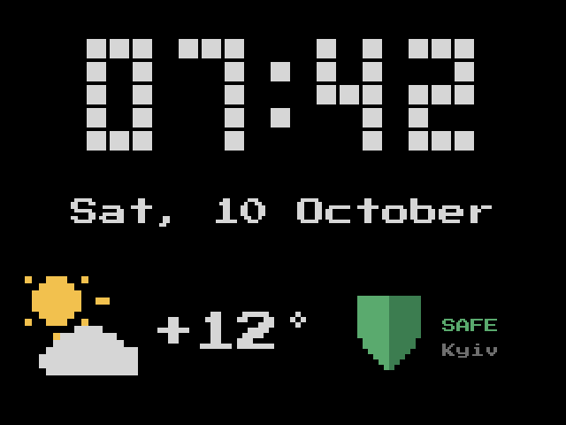
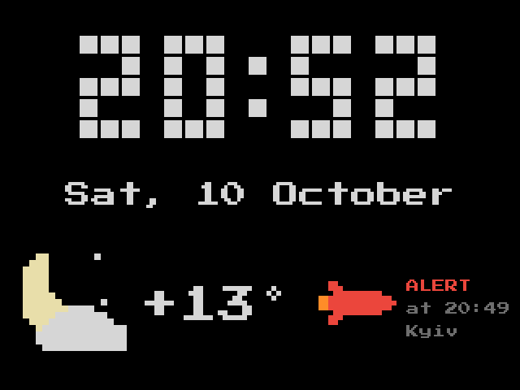
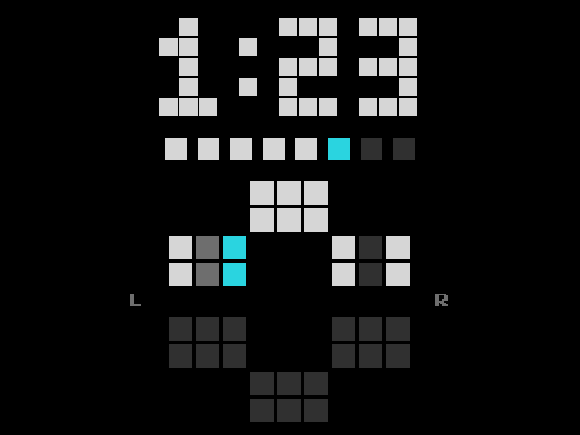
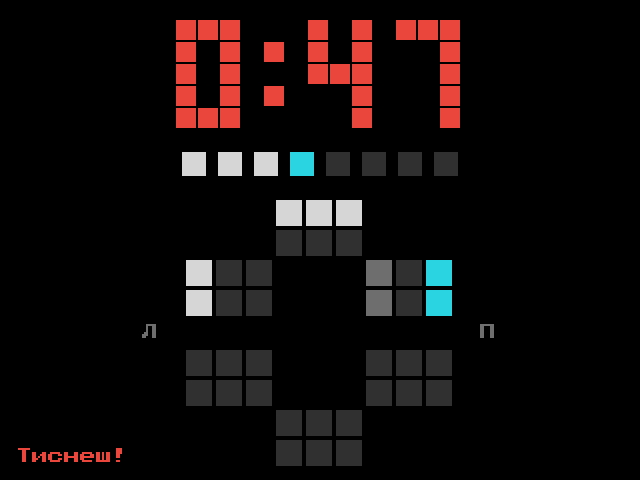
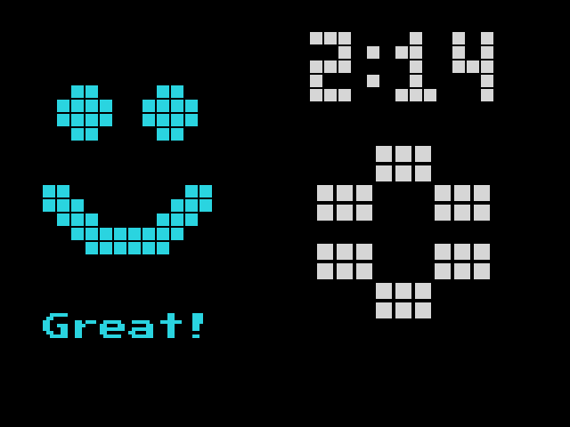
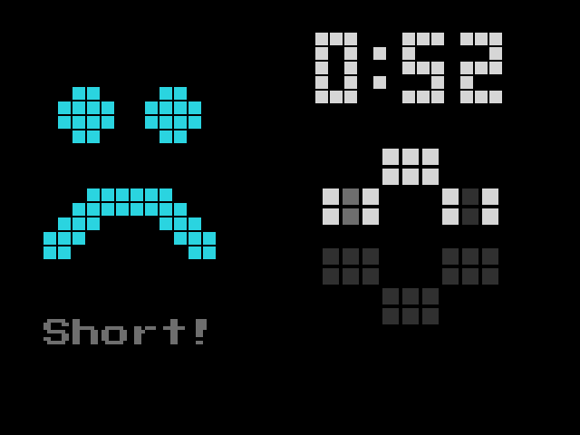
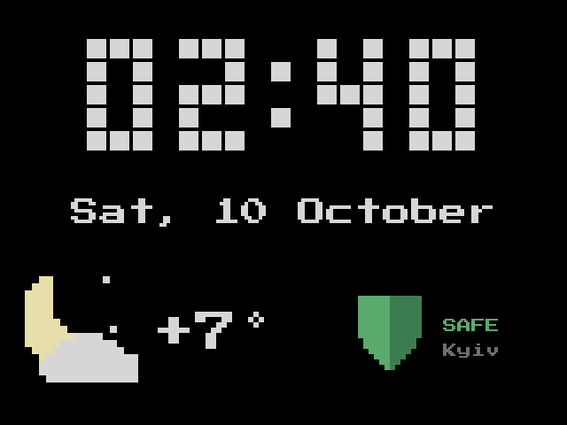
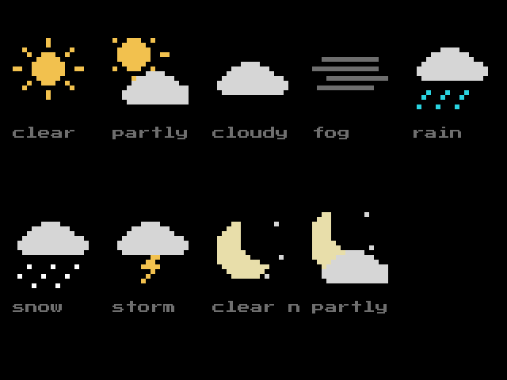

# esp-oralb

esp-oralb is firmware for the ESP32-2432S024C display board. The display shows the data from an Oral-B iO toothbrush. It also
shows the time, the date, the weather and the air-raid alert status for one region of Ukraine.

## Screenshots

<table>
<tr><td><br>Clock</td><td><br>Clock with an air-raid alert</td></tr>
<tr><td><br>Brushing, current zone in cyan</td><td><br>Too much pressure</td></tr>
<tr><td><br>Result: 2 minutes or more</td><td><br>Result: less than 2 minutes</td></tr>
<tr><td><br>Night</td><td><br>Weather icons</td></tr>
</table>

The screenshots show the English text. The default language is Ukrainian. To change the language, refer to
[Change the settings](#change-the-settings).

## Equipment

* ESP32-2432S024C board (2.4 in, 320x240, "Cheap Yellow Display").
* USB-A to USB-C cable.
* Oral-B iO toothbrush. The Bluetooth setting in the toothbrush menu must be on.
* Wi-Fi network, 2.4 GHz, with internet access.
* Computer with git and PlatformIO Core 6.2 or later.
* For the tests: a C++ compiler (clang++ or g++).
* For the tools in `tools/`: [uv](https://docs.astral.sh/uv/).

The board has a CH340 USB-serial chip. macOS 12 (and later) and Linux have the driver. On Windows and on older macOS, install
the WCH CH34x driver.

## Install the firmware

1. Clone the repository. Go to the root directory of the repository.
2. Copy the example secrets file:
   ```
   cp include/secrets.example.h include/secrets.h
   ```
3. Open `include/secrets.h`. Change `OTA_PASSWORD` to a new password. You use this password for the web page and for the
   updates over Wi-Fi.
4. Optional: open `include/config.h` and change the default values. You can change most of these values on the web page later.
5. Connect the board to the computer with the USB cable.
6. Build the firmware and upload it:
   ```
   pio run -t upload
   ```
7. If the upload cannot connect to the board, push and hold the BOOT button. Release the button when the upload starts.

The first build takes approximately 3 minutes.

NOTE: When you open the serial port, the board restarts. To see the serial log, use `pio device monitor` (115200 baud).

If the image is mirrored or turned, or if the colours are incorrect, add one of these flags to `build_flags` in
`platformio.ini`: `BOARD_TFT_OFFSET_ROTATION`, `BOARD_TFT_RGB_ORDER_BGR`, `BOARD_TFT_INVERT`. Then upload the firmware again.

## Connect to Wi-Fi

1. Start the board. If the board has no saved network, the LED is blue. The screen shows "Wi-Fi: join esp-oralb-setup".
2. On a phone, connect to the open Wi-Fi network **esp-oralb-setup**. The setup page opens. If the setup page does not open,
   go to http://192.168.4.1.
3. Select your network. Use a 2.4 GHz network.
4. Type the network password and save.
5. The display connects to the network and gets the time from the internet.

To change the network later, do one of these steps:

* Push and hold the BOOT button for 5 seconds.
* On the web page, push **Wi-Fi setup portal**.

The setup network is then available for 3 minutes, and the LED is blue. If you do not save a new network, the display keeps the
old network.

If the saved network is not available, the display tries to connect again and again. The setup network does not open
automatically. The toothbrush screens operate without Wi-Fi.

## Use the display

### Clock screen

The clock screen shows:

* The time and the date.
* The weather icon and the temperature. The display hides them if it has no weather data for 3 hours.
* The air-raid alert block: the alert status, the time when this status started and the city.
* The status line: "Waiting for brush...".

| Alert block | Meaning |
|---|---|
| Red missile, ALERT | Air-raid alert |
| Yellow drone, THREAT | Threat |
| Green shield, SAFE | No alert |
| No block | No alert data for 2 minutes |

If the display does not have the time, the clock shows `--:--`.

### Brushing screen

Start the toothbrush. The display shows the brushing screen automatically.

* The timer is white. It is red when the pressure is too high. It is cyan after 2:00.
* The 8 squares show the progress. Each square is 15 seconds. The current square flashes.
* The teeth chart shows 16 zones. The current zone is cyan. A zone becomes white after 7.5 seconds of brushing. The chart
  shows only if the toothbrush sends motion data.
* "Too hard!" shows when the pressure is too high.

### Result screen

Stop the toothbrush. The display shows the result screen:

* A happy face and "Great!" if you brushed for 2 minutes or more.
* A sad face and "Short!" if you brushed for less than 2 minutes.
* The brushing time and the teeth chart.

The result screen shows for 15 seconds. If you put the toothbrush on the charger, it shows for 5 seconds. The display does not
show a result for a session of less than 5 seconds.

### LED

| LED | Meaning |
|---|---|
| Dim green | Brushing |
| Red, flashes | Pressure is too high |
| Green, 3 flashes | Brushing time is 2:00 |
| Blue | The Wi-Fi setup network is open |
| Off | All other conditions, and always at night |

### Backlight and night mode

The backlight brightness changes with the light in the room.

At night (default: 23:00 to 07:00), the backlight goes off 8 seconds after the clock screen shows. To turn on the backlight for
8 seconds, touch the screen. When you start the toothbrush, the backlight comes on.

## Use the web page

1. Go to **http://esp-oralb.local/**. If this address does not work, use the IP address of the display.
2. Type the user name `esp-oralb` and the password `OTA_PASSWORD` from `include/secrets.h`.

The web page has 4 sections: **Status**, **Time**, **Settings** and **Device**.

### Set the time

The display gets the time from the internet. It saves the time in its memory every 10 minutes. If the power goes off and the
internet is not available, the display shows the last saved time. This time is late by the period without power.

To set the time manually, do one of these steps in the **Time** section:

* Push **Use this device's time**.
* Type the date and the time, and push **Set**.

When the internet is available again, the display replaces the manual time with the internet time.

The **Source** field shows where the time comes from:

| Source | Meaning |
|---|---|
| `ntp` | Internet time |
| `manual` | Time from the web page |
| `rtc` | Time kept after a restart without power loss |
| `restored` | Last saved time after a power loss. The time is late. |
| `none` | No time |

### Change the settings

1. Change the values in the **Settings** section.
2. Push **Save**.

The display uses the new values immediately. A restart is not necessary. If a value is not correct, the page shows an error and
the display does not change the settings.

| Field | Key | Default | Description |
|---|---|---|---|
| Latitude, Longitude | `lat`, `lon` | 50.45, 30.52 | Location for the weather |
| Location name | `loc` | Kyiv | Name for your reference. The screen does not show it. |
| Alert region id | `region` | 31 | 31 = Kyiv city, 14 = Kyiv oblast |
| Time zone | `tz` | `EET-2EEST,M3.5.0/3,M10.5.0/4` | POSIX TZ string |
| Night starts, Night ends | `night_start`, `night_end` | 23, 7 | Hours of the night mode. If the two values are equal, the night mode is off. |
| Night wake after touch | `night_wake` | 8 | Seconds |
| Light sensor: bright reading | `ldr_bright` | 150 | Sensor value for the maximum backlight |
| Light sensor: dark reading | `ldr_dark` | 1500 | Sensor value for the minimum backlight |
| Backlight min, max | `bl_min`, `bl_max` | 20, 255 | 0 to 255 |
| LED max brightness | `led_max` | 40 | 0 to 255 |
| Display language | `lang` | `uk` | `uk` (Ukrainian) or `en` (English) |
| Show weather | `show_weather` | on | |
| Show air-raid alert | `show_alert` | on | |
| Show zone map | `show_zones` | on | |

To adjust the light sensor:

1. Make the room bright. Read the first value of "Light sensor raw / level / backlight" in the **Status** section. Type this
   value in **Light sensor: bright reading**.
2. Make the room dark. Read the value again. Type this value in **Light sensor: dark reading**.
3. Push **Save**.

### Restart the display

In the **Device** section, push **Reboot**.

### HTTP API

All requests need the user name and the password. All POST requests also need the header `X-Requested-With`.

| Request | Function |
|---|---|
| `GET /api/status` | Gives the status as JSON |
| `GET /api/settings` | Gives the settings as JSON |
| `POST /api/settings` | Changes the settings. Send one or more keys from the settings table, form-encoded. |
| `POST /api/time` | Sets the time. Send `epoch=<UTC seconds>` or `local=YYYY-MM-DDTHH:MM`. |
| `POST /api/reboot` | Restarts the display |
| `POST /api/portal` | Opens the Wi-Fi setup network |

Example:

```
curl -u esp-oralb:<password> -H 'X-Requested-With: x' -d lang=en http://esp-oralb.local/api/settings
```

## Update the firmware over Wi-Fi

Before the first update over Wi-Fi, upload the firmware with the USB cable. Refer to [Install the firmware](#install-the-firmware).

1. Make sure that the display shows the clock screen. Do not update during brushing.
2. Upload the firmware:
   ```
   ESP_ORALB_OTA_PASSWORD=<password> pio run -e cyd_ota -t upload
   ```

During the update, the screen shows "Updating..." and the percentage. After the update, the display restarts. If the update
fails, the screen shows "Update failed" for 3 seconds. The display then continues with the old firmware.

## Read the log

Connect to the display with telnet on port 23:

```
nc esp-oralb.local 23
```

The display sends the last 32 lines, then the new lines. Two clients can connect at the same time.

## Change the firmware

### Run the tests

```
pio test -e native
cd tools/python && uv run pytest
```

### Change the screen design

The file `tools/design/design.py` contains the screen design and the screen texts.

1. Change `tools/design/design.py`.
2. Make the firmware header and the test images:
   ```
   uv run --project tools/python --with pillow python tools/design/design.py gen
   uv run --project tools/python --with pillow python tools/design/design.py golden
   ```
3. Run the tests.
4. Optional: make the PNG images of all screens. `OUT` gets the Ukrainian images and `OUT/en` gets the English images:
   ```
   uv run --project tools/python --with pillow python tools/design/design.py mock OUT
   ```
5. Optional: make the screenshots for this file again:
   ```
   uv run --project tools/python --with pillow python tools/design/design.py mock docs/screenshots en
   ```

### Change the web page

1. Change `tools/web/index.html`.
2. Make the firmware header:
   ```
   python3 tools/gen_web.py
   ```
3. Build the firmware.

### Record the zones and train the zone model

To record the zones and train a new model, refer to [tools/python/README.md](tools/python/README.md). Then make the firmware
header and build the firmware:

```
python3 tools/gen_model_header.py
```

### Directory layout

| Directory | Contents |
|---|---|
| `include/` | Pins (`board.h`), default values (`config.h`), secrets, generated headers |
| `src/` | Firmware: display, Bluetooth, Wi-Fi, web page, log |
| `lib/core/` | Firmware parts that the tests use on the computer |
| `test/` | Tests and test data |
| `tools/design/` | Screen design and font |
| `tools/web/` | Web page source |
| `tools/python/` | Python tools: display on the computer, zone recording and training |
| `docs/screenshots/` | Screenshots for this file |

## Licence of the font

The screen font is Press Start 2P by The Press Start 2P Project Authors, SIL Open Font License 1.1
(`tools/design/OFL.txt`).
